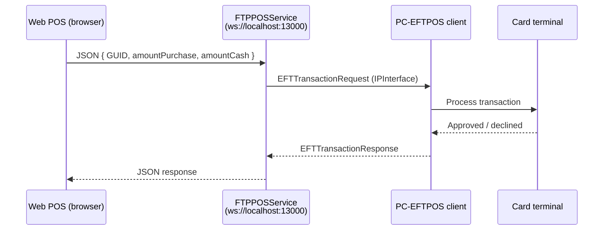

<div align="center">

# 💳 TL EFT-POS Bridge

**Connect browser-based POS systems to PC-EFTPOS payment terminals through a local WebSocket bridge.**


[](LICENSE)

</div>

---

## Overview

Web POS applications cannot talk to card terminals directly. TL EFT-POS runs on the checkout PC as a small Windows app that opens a WebSocket server on `ws://localhost:13000`. The web POS sends a JSON payment request; the bridge forwards it to the PC-EFTPOS client through the official `PCEFTPOS.EFTClient.IPInterface` SDK and streams the terminal's response back to the browser.

## Features

- 🌉 **WebSocket bridge** on port `13000` for any browser-based POS
- 💳 **Purchase with optional cash-out** in a single request (`PurchaseCash`)
- 🔁 **Asynchronous responses** returned to the requesting browser session
- 🖥️ **WPF test client** (`EFTPOS_XC`) for configuring and testing terminals
- 🧪 **Console WebSocket test harness** and an `index.html` test page
- 📝 Transaction logging

## Architecture



## Tech stack

| Component | Technology |
| --- | --- |
| Bridge | C# · WinForms · .NET Framework 4.8 · raw WebSocket server on `TcpListener` |
| Payments SDK | `PCEFTPOS.EFTClient.IPInterface` 1.4.5 |
| Test client | WPF (`EFTPOS_XC`) |
| Serialization | Newtonsoft.Json |

## Getting started

### Prerequisites

- Windows with .NET Framework 4.8
- Visual Studio 2019+
- PC-EFTPOS (Linkly) client installed and paired with a terminal, or its simulator

### Build

```shell
git clone https://github.com/mr-aybee/tl-eft-pos.git
cd tl-eft-pos
nuget restore FTPPOSService.sln
msbuild FTPPOSService.sln /p:Configuration=Release
```

## Usage

1. Start **FTPPOSService** on the checkout PC and set the EFT client host and port.
2. From your web POS, connect and send a request:

   ```js
   const ws = new WebSocket("ws://localhost:13000");
   ws.onmessage = (e) => console.log("EFT response", JSON.parse(e.data));
   ws.onopen = () => ws.send(JSON.stringify({ GUID: crypto.randomUUID(), amountPurchase: 12.50, amountCash: 0 }));
   ```

3. Approve the transaction on the terminal; the result is pushed back over the same socket.
4. Use `index.html` or `EFTPOS_ConsoleWEBSocketTest` to test without a POS.

> ⚠️ Keep the bridge bound to the local machine, run against the EFT simulator while developing, and never log full card data.

## Project structure

```text
tl-eft-pos/
├── FTPPOSService.sln
├── FTPPOSService/                # WebSocket bridge + EFT client integration
├── EFTPOS_XC/                    # WPF terminal configuration/test client
├── EFTPOS_ConsoleWEBSocketTest/  # Console WebSocket test harness
└── index.html                    # Browser test page
```

## Development

- Open `FTPPOSService.sln` in Visual Studio; NuGet packages are restored from `packages/`.
- Test against the PC-EFTPOS simulator before using real terminals.

## Contributing

Contributions are welcome. Read [CONTRIBUTING.md](CONTRIBUTING.md) for the branch, build and pull-request workflow. Please report security issues privately through [GitHub security advisories](https://github.com/mr-aybee/tl-eft-pos/security/advisories/new), not public issues.

## Code of Conduct

This project follows the [Contributor Covenant](CODE_OF_CONDUCT.md). By participating you agree to uphold it.

## License

Released under the [MIT License](LICENSE). © 2026 Abdullah Shahid.
